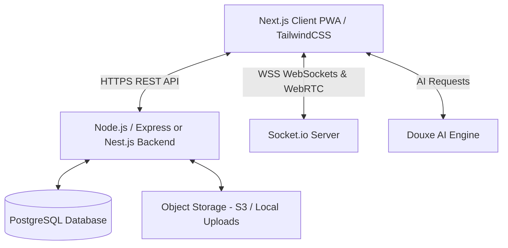

# التوثيق الشامل والهندسي لمنصة TAXI-NAGUILOU (تاكسي نقيلو)
## دليل إعادة بناء وبرمجة المنصة بالكامل (Full System Architecture & Recreation Blueprint)

---

## 1. نظرة عامة على المنصة (Platform Overview)
**تاكسي نقيلو (TAXI-NAGUILOU)** هي منصة برمجية خدمية متكاملة (**SaaS - Software as a Service**) مصممة خصيصاً لإدارة مكاتب ومؤسسات وسيارات الأجرة (Taxis) والنقل الجماعي والحضري، ومطابقة للقوانين والتنظيمات الجزائرية المعمول بها (مثل قانون العمل 11/90، تنظيمات مديرية النقل، الضمان الاجتماعي للعمال الأجراء CNAS، ومصلحة الضرائب والمناجم).

### الأهداف الأساسية للمنصة:
1. **أتمتة إدارة الأسطول والمركبات:** متابعة الوثائق الإدارية وتواريخ انتهاء الصلاحية (المراقبة التقنية، التأمين، شهادة سيرغاز GPL، قارورة الإطفاء، وعداد التاكسي - الساكوريومتر).
2. **إدارة السائقين والملاك (Owners & Drivers):** ملفات السائقين، رخص السياقة، رخص الاستغلال، الشهادات الطبية، وفترات التربص (Probation).
3. **التوليد الآلي والتوقيع الإلكتروني للعقود:** عقود عمل نظامية قانونية (16 مادة قانونية وفق القانون الجزائري 90-11) مع إمكانية التوقيع الرقمي.
4. **نظام الإجازات وتعيين السائق البديل:** إدارة العطل والتعويض التلقائي المؤقت للسائقين لتفادي توقف الخدمة.
5. **الفوترة والاشتراكات المالية:** متابعة مداخيل المنصة لكل مركبة، الفواتير المدفوعة والمعلقة، والتحصيل عبر البريد الجاري (CCP/RIP) أو البنك.
6. **جداول الإرسال ومناوبة التاكسي (Bordereaux de transmission / Permanence):** تنظيم دوريات ومناوبات سيارات الأجرة.
7. **التواصل اللحظي والدعم بالذكاء الاصطناعي:** دردشة ومكالمات صوتية عبر WebSockets و WebRTC، بالإضافة إلى مساعد الذكاء الاصطناعي المدمج (**Douxe AI**).

---

## 2. البنية التقنية ومكونات النظام (Technology Stack)



### أ) الواجهة الأمامية (Frontend):
- **الإطار:** Next.js (App Router) مع React.
- **التصميم:** TailwindCSS مخصص مع متغيرات CSS (CSS Variables) لدعم السمة الفاتحة والداكنة (Dark/Light Mode)، ومظهر الزجاج (Glassmorphism).
- **التوافق:** تطبيق ويب تقدمي (**PWA**) متوافق بالكامل مع الهواتف الذكية مع شاشة تثبيت وملف `manifest.json`.
- **دعم اللغات:** نظام ثنائي اللغة مع دعم كامل للغة العربية (RTL) والفرنسية (LTR) مع تبديل لحظي للسياق (`LanguageProvider`).
- **الاتصال المباشر:** Socket.io-client للتنبيهات والرسائل الفورية ومكالمات WebRTC.

### ب) الواجهة الخلفية والخوادم (Backend & Infrastructure):
- **الخادم السحابي المستضاف:** Railway Cloud Platform (`https://taxi-nguilo-production.up.railway.app`).
- **خادم الواجهة الخلفية:** Node.js (TypeScript) مبني بـ Express أو NestJS.
- **قاعدة البيانات:** PostgreSQL مع محرك Prisma ORM أو TypeORM (مفاتيح UUID لجميع الكيانات).
- **الأمان والتحقق:** JSON Web Tokens (JWT)، تشفير Passwords بـ Bcrypt، نظام حماية من خطوتين (2FA - Two-Factor Authentication)، ومحدد معدل الطلبات (Rate Limiting).
- **تخزين المستندات والصور:** Base64 أو تخزين سحابي مع ضغط تلقائي للصور (`compressImageOrFile`).

---

## 3. هندسة قاعدة البيانات ونماذج البيانات (Database Schema Models)

### نموذج 1: المستخدم (User)
| الحقل (Field) | النوع (Type) | الوصف |
| :--- | :--- | :--- |
| `id` | UUID (PK) | المعرف الفريد |
| `email` | String (Unique) | البريد الإلكتروني |
| `password` | String (Hash) | كلمة المرور المشفرة |
| `firstName` | String | الاسم الشخصي |
| `lastName` | String | اللقب العائلي |
| `phone` | String | رقم الهاتف |
| `role` | Enum | `SUPER_ADMIN` \| `ADMIN` \| `OWNER` \| `DRIVER` |
| `status` | Enum | `ACTIVE` \| `TEMPORARY` \| `SUSPENDED` |
| `grade` | Enum | `PROPRIETAIRE` (مالك) \| `CHAUFFEUR` (سائق) |
| `plan` | Enum | باقة الاشتراك (`FREE` \| `PRO` \| `PREMIUM`) |
| `isTwoFactorEnabled` | Boolean | تفعيل التحقق بخطوتين |
| `identityCardNumber` | String? | رقم بطاقة التعريف الوطنية |
| `licenseNumber` | String? | رقم رخصة السياقة |
| `licenseExpiry` | DateTime? | تاريخ انتهاء رخصة السياقة |
| `taxiLicenseIssueDate`| DateTime? | تاريخ إصدار رخصة استغلال سيارة الأجرة |
| `taxiLicenseExpiry` | DateTime? | تاريخ انتهاء رخصة الاستغلال |
| `medicalCertificateExpiry`| DateTime? | تاريخ انتهاء صلاحية الشهادة الطبية |
| `cnasStatus` | String? | وضعية الضمان الاجتماعي CNAS |
| `probationPeriod` | String? | فترة التربص (`TRIAL_1`, إلخ) |
| `qrToken` | UUID? | رمز الاستجابة السريع للبطاقة المهنية |
| `organizationId` | UUID (FK) | معرف المؤسسة / الشركة |

### نموذج 2: المركبة (Vehicle)
| الحقل (Field) | النوع (Type) | الوصف |
| :--- | :--- | :--- |
| `id` | UUID (PK) | المعرف الفريد |
| `ownerId` | UUID (FK) | معرف المالك الأصلي |
| `replacementDriverId`| UUID (FK)? | معرف السائق البديل في حال العطلة |
| `brand` | String | ماركة السيارة (مثال: Hyundai, Dacia, Renault) |
| `model` | String | الموديل (مثال: Accent, Logan, Symbol) |
| `plateNumber` | String (Unique) | رقم لوحة الترقيم (مثال: 09415-114-01) |
| `color` | String | لون السيارة |
| `doorNumber` | String | رقم الباب المعتمد لسيارة الأجرة (مثال: (02/22)-90) |
| `insuranceExpiry` | DateTime? | تاريخ انتهاء التأمين |
| `technicalControl` | DateTime? | تاريخ الفحص التقني الدوري |
| `extinguisherExpiry` | DateTime? | تاريخ انتهاء صلاحية مطفأة الحريق |
| `gplExpiry` | DateTime? | تاريخ صلاحية خزان وفحص غاز البترول المسال GPL |
| `saccuriometreExpiry`| DateTime? | تاريخ انتهاء شهادة مطابقة عداد التاكسي |
| `saccuriometreText` | String? | ملاحظة العداد (مثال: "بدون عداد") |
| `status` | Enum | `ACTIVE` \| `SUSPENDED` \| `PENDING` |
| `suspendedReason` | String? | سبب التوقيف أو التعليق |
| `hasInsuranceFile` | Boolean | وجود ملف التأمين المرفوع |
| `hasTechnicalControlFile`| Boolean | وجود ملف الفحص التقني |
| `hasGreyCardFile` | Boolean | وجود ملف البطاقة الرمادية |
| `hasTaxiLicenseFile`| Boolean | وجود ملف رخصة الاستغلال |

### نموذج 3: العقد (Contract)
| الحقل (Field) | النوع (Type) | الوصف |
| :--- | :--- | :--- |
| `id` | UUID (PK) | المعرف الفريد للعقد |
| `contractNumber` | String (Unique) | رقم العقد التسلسلي (مثال: CT-2026-0086) |
| `partnerId` | UUID (FK) | معرف السائق أو المالك الطرف الثاني |
| `vehicleId` | UUID (FK) | معرف المركبة المعنية |
| `startDate` | DateTime | تاريخ سريان العقد |
| `endDate` | DateTime | تاريخ انتهاء العقد (افتراضياً 5 سنوات) |
| `status` | Enum | `DRAFT` \| `PENDING` \| `SIGNED` \| `TERMINATED` |
| `terms` | Text | بنود ومواد العقد القانونية الـ 16 (باللغة العربية) |
| `signedAt` | DateTime? | وقت وتاريخ التوقيع الإلكتروني |
| `isTrashed` | Boolean | هل العقد في سلة المهملات |

### نموذج 4: الإجازات والغياب (Leave)
| الحقل (Field) | النوع (Type) | الوصف |
| :--- | :--- | :--- |
| `id` | UUID (PK) | المعرف |
| `driverId` | UUID (FK) | معرف السائق المستفيد من الإجازة |
| `vehicleId` | UUID (FK) | المركبة المعنية |
| `replacementDriverId`| UUID (FK)? | السائق المعين للقيادة أثناء الإجازة |
| `startDate` | DateTime | تاريخ بداية العطلة |
| `endDate` | DateTime | تاريخ نهاية العطلة |
| `reason` | String | سبب العطلة |
| `status` | Enum | `PENDING` \| `APPROVED` \| `REJECTED` |

### نموذج 5: الفوترة والاشتراكات (Billing & Payments)
| الحقل (Field) | النوع (Type) | الوصف |
| :--- | :--- | :--- |
| `id` | UUID (PK) | معرف الفاتورة |
| `vehicleId` | UUID (FK) | معرف المركبة |
| `amount` | Decimal | المبلغ المطلوب (دج) |
| `paidAmount` | Decimal | المبلغ المسدد |
| `period` | String | الفترة (مثال: شهر 09/2026) |
| `paymentDate` | DateTime? | تاريخ الدفع |
| `status` | Enum | `PAID` \| `PENDING` \| `OVERDUE` |
| `receiptUrl` | String? | وصل الدفع أو التحويل |

---

## 4. شرح تفصيلي لجميع صفحات المنصة وخصائصها (Pages & Features)

### 1. صفحة تسجيل الدخول (`/login`)
- **الوظيفة:** نقطة الدخول المحمية لجميع مستخدمي المنصة (المشرفين، الملاك، والسائقين).
- **الخصائص:**
  - حقول الإدخال: البريد الإلكتروني وكلمة المرور مع زر إظهار/إخفاء كلمة المرور.
  - خيار استرجاع كلمة المرور (`Forgot Password`) مع إرسال رمز تحقق مكوّن من 6 أرقام.
  - دعم الدخول بحساب Google OAuth.
  - التحقق بخطوتين (2FA) عند التفعيل.
  - زر تبديل اللغة (عربي / فرنسي) وزر تبديل الوضع (ليلي / نهاري).
  - رسائل أخطاء تفاعلية مترجمة (مستخدم غير موجود، كلمة مرور خاطئة، حساب قيد المراجعة).

### 2. صفحة التسجيل الجديد والانضمام (`/register`)
- **الوظيفة:** تسجيل سائق أو مالك سيارة أجرة جديد بالمنصة.
- **الخصائص:**
  - تسجيل الاسم واللقب، رقم الهاتف، البريد الإلكتروني، وكلمة المرور.
  - رفع الوثائق الأولية (بطاقة التعريف، رخصة السياقة).
  - توجيه المستخدم بعد التسجيل إلى صفحة الانتظار والترحيب (`/welcome`) حتى يقوم مدير النظام بقبول حسابه.

### 3. صفحة الترحيب وتأكيد الحساب (`/welcome`)
- **الوظيفة:** شاشة إشعار للمستخدم الجديد تفيد بأن حسابه يخضع للتحقق والتدقيق من طرف الإدارة قبل منحه الصلاحيات الكاملة (`PENDING_VALIDATION`).

### 4. لوحة التحكم الرئيسية (`/dashboard`)
- **الوظيفة:** اللوحة التنفيذية الشاملة (Executive KPI Dashboard) لمدير النظام أو مالك الأسطول.
- **الخصائص:**
  - **بطاقات مؤشرات الأداء الحية (KPI Cards):**
    - إجمالي الملاك / السائقين (Total Merchants) مع نسبة النشطين.
    - إجمالي المركبات في الأسطول (Total Fleet)، المركبات النشطة، والمركبات الموقوفة.
    - إجمالي العقود السارية والعقود المفسوخة.
    - مؤشرات الفوترة: المبالغ المحصلة (DZD)، المبالغ المعلقة، وعدد المركبات التي سددت اشتراكها.
  - **الرسوم البيانية التفاعلية:**
    - منحنى تطور رقم الأعمال والإيرادات الشهرية والسنوية (`/stats/revenue-evolution`).
    - مخطط توزيع المركبات حسب الحالة.
  - **سجل النشاطات الأخيرة (Recent Activity):** عرض آخر العمليات (تسجيل مركبة، توقيع عقد، دفع اشتراك، إضافة سائق).

### 5. إدارة الأسطول المباشر (`/dashboard/fleet`)
- **الوظيفة:** خريطة وتتبع الأسطول الميداني.
- **الخصائص:**
  - عرض قائمة السيارات مع السائق النشط حالياً لكل مركبة.
  - فرز سريع: المركبات النشطة، في الخدمة، قيد التوقيف، أو التي يقودها سائق بديل.
  - شارات تنبيه للمركبات التي تقترب وثائقها من الانتهاء.

### 6. إدارة المركبات (`/dashboard/vehicles`)
- **الوظيفة:** السجل الكامل لسيارات الأجرة التابعة للمؤسسة.
- **الخصائص:**
  - زر إضافة مركبة جديدة مع نموذج مفصل:
    - بيانات المركبة: الصانع، الموديل، رقم اللوحة (Matricule)، اللون، رقم الباب (Numéro de porte).
    - بيانات الوثائق وتواريخ الصلاحية:
      - تاريخ انتهاء التأمين (Assurance).
      - الفحص التقني (Contrôle technique).
      - قارورة الإطفاء (Extincteur).
      - فحص غاز البترول المسال (GPL).
      - عداد التاكسي (الساكوريومتر) أو تحديد "بدون عداد".
    - رفع صور الوثائق (البطاقة الرمادية، محضر الفحص، رخصة الاستغلال، التأمين).
  - أدوات التعديل، التعليق المؤقت (مع ذكر السبب)، أو الحذف.
  - تصدير القائمة والبحث السريع برقم اللوحة أو اسم السائق.

### 7. إدارة السائقين والملاك (`/dashboard/owners`)
- **الوظيفة:** الملف الشخصي والمهني لكل سائق ومالك.
- **الخصائص:**
  - بيانات الهوية والاتصال (الاسم، اللقب، الهاتف، البريد).
  - الرخص والشهادات: رقم رخصة السياقة وتاريخ انتهائها، الشهادة الطبية وتاريخ صلاحيتها، رخصة استغلال سيارة الأجرة.
  - متابعة فترات التربص والتجريب (Probation Period).
  - ربط السائق بالمركبات التي يقودها حالياً.
  - توليد رمز الاستجابة السريع (QR Code) الخاص بالسائق لبطاقة المهنة.

### 8. إدارة العقود والتوقيع الرقمي (`/dashboard/contracts`)
- **الوظيفة:** إنشاء وتوثيق عقود العمل والانتساب القانونية.
- **الخصائص:**
  - **التوليد الآلي للعقد:** توليد رقم تسلسلي فريد (مثل `CT-2026-0112`).
  - **بنود العقد المدمجة:** 16 مادة قانونية مطابقة للقانون 11/90 المتعلق بعلاقات العمل في الجزائر.
  - **التوقيع الإلكتروني (Digital Signature):** واجهة مخصصة لتوقيع العقد من السائق والمدير مباشرة على الشاشة أو عبر الهاتف.
  - تحميل العقد بصيغة PDF قابلة للطباعة الرسمية.
  - فلترة العقود: موقعة (Signed)، مسودة (Draft)، منتهية، أو مفسوخة.

### 9. إدارة الإجازات والعطل (`/dashboard/leaves`)
- **الوظيفة:** تنظيم غياب السائقين وضمان استمرارية استغلال سيارات الأجرة.
- **الخصائص:**
  - تقديم طلب إجازة مع تحديد تاريخ البداية والنهاية والسبب.
  - تعيين سائق بديل (Chauffeur Remplaçant) لنفس المركبة خلال مدة العطلة.
  - اعتماد الطلب من طرف الإدارة وتغيير حالة السائق في النظام تلقائياً حتى تاريخ العودة.

### 10. الإدارة المالية والتقارير (`/dashboard/finances`)
- **الوظيفة:** الرقابة المالية ومداخيل المؤسسة.
- **الخصائص:**
  - ملخص الإيرادات الإجمالية المحصلة.
  - التوزيع المالي السنوي والشهري (`/finances/my-yearly-breakdown`).
  - سجل مداخيل كل سائق ومركبة.
  - إحصائيات المقارنة بين الأشهر ومعدل النمو المالي.

### 11. الفوترة واشتراكات الأسطول (`/dashboard/billing`)
- **الوظيفة:** متابعة مستحقات واشتراكات سيارات الأجرة الشهرية والسنوية.
- **الخصائص:**
  - جدول يبين حالة كل مركبة: مدفوعة (Paid) أو معلقة (Pending).
  - تحديد المبالغ المستحقة وطريقة الدفع المعتمدة (نقداً، تحويل بنكي، بريد الجزائر CCP).
  - إمكانية إلغاء أو تأكيد الدفعات وتوليد وصولات الاستلام.

### 12. جداول الإرسال ومناوبة التاكسي (`/dashboard/transmission-slips`)
- **الوظيفة:** إدارة وثائق المداومة وجداول الإرسال الإدارية (Bordereaux de transmission / Permanence).
- **الخصائص:**
  - إنشاء جدول دوريات ومناوبات سيارات الأجرة الليلية أو أيام العطل الرسمية.
  - طباعة جداول الإرسال الرسمية لتقديمها لمصالح مديرية النقل أو الأمن الوطني.

### 13. تأمينات الضمان الاجتماعي (`/dashboard/cnas-insurance`)
- **الوظيفة:** تتبع الوضعية القانونية للسائقين تجاه صندوق التأمينات الاجتماعية (CNAS).
- **الخصائص:**
  - تتبع السائقين المصرح بهم والأجراء.
  - تنبيهات الدفع الفصلي للاشتراكات والشهادات السنوية.

### 14. تأمينات المركبات (`/dashboard/insurance`)
- **الوظيفة:** جدول زمني موحد لجميع بوالص تأمين المركبات.
- **الخصائص:**
  - عداد تنازلي للأيام المتبقية قبل انتهاء تأمين كل مركبة.
  - فرز المركبات التي تحتاج إلى تجديد التأمين خلال 30 أو 15 يوماً.

### 15. محاضر وتقارير المسافرين (`/dashboard/traveler-reports`)
- **الوظيفة:** تسجيل الرحلات الطويلة وتقارير المسافرين ودفاتر العبور (PV de voyageurs).
- **الخصائص:**
  - تسجيل بيانات الرحلات بين الولايات والمدن.
  - أرشفة المحاضر القانونية لضمان الامتثال لدفتر الشروط.

### 16. إدارة المستخدمين والصلاحيات (`/dashboard/users`)
- **الوظيفة:** إدارة فريق العمل وأذونات الوصول.
- **الخصائص:**
  - إضافة مستخدمين جدد بأدوار محددة (`SUPER_ADMIN`, `ADMIN`, `OPERATOR`).
  - تحديد صلاحيات مخصصة (إضافة مركبات، تعديل عقود، حذف سجلات، الاطلاع على الفوترة فقط).
  - تفعيل أو تجميد حساب أي مستخدم بنقرة واحدة.

### 17. نظام المحادثات والمكالمات الفورية (`/dashboard/chat`)
- **الوظيفة:** مركز تواصل داخلي فوري بين الإدارة والسائقين.
- **الخصائص:**
  - رسائل نصية فورية عبر بروتوكول WebSockets.
  - **مكالمات صوتية مباشرة (WebRTC Voice Calls):** إمكانية الاتصال الصوتي المباشر بالسائق بدون تكلفة هاتفية مع حفظ ملخص المكالمة ومدتها (`call_summary`).
  - إشعار بالرسائل غير المقروءة ومؤشر حالة الاتصال (متصل الآن / غير متصل).

### 18. مركز التنبيهات والإشعارات (`/dashboard/notifications`)
- **الوظيفة:** محرك تنبيهات آلي ومتقدم.
- **الخصائص:**
  - تنبيهات فورية عند اقتراب انتهاء أي وثيقة (تأمين، فحص، عداد، رخصة سياقة).
  - إشعارات الدفع والتحويلات المالية.
  - إمكانية تحديد الكل كمقروء وتصفية التنبيهات حسب النوع.

### 19. سجل التدقيق والرقابة (`/dashboard/audit-logs`)
- **الوظيفة:** تسجيل أمني كامل لجميع الأحداث الحساسة (Security Audit Trail).
- **الخصائص:**
  - تسجيل من قام بالعملية، نوع الإجراء (تعديل، حذف، إنشاء)، التوقيت بالثانية، وعنوان IP.
  - منع التلاعب بالبيانات الحساسة كحذف العقود أو تغيير أرقام الدفعات.

### 20. نظام الانتساب والإحالة (`/dashboard/affiliate`)
- **الوظيفة:** برنامج انتساب يسمح بإضافة مركبات جديدة وتوسيع شبكة السائقين التابعين للمؤسسة.

### 21. إعدادات المنصة والشركة (`/dashboard/settings`)
- **الوظيفة:** تخصيص الهوية التجارية والبيانات الجبائية والقانونية للمؤسسة.
- **الخصائص:**
  - **البيانات القانونية والجبائية الجزائرية:**
    - رقم السجل التجاري (Registre de Commerce).
    - رقم المادة الضريبية (Article d'imposition).
    - رقم التعريف الجبائي (NIF).
    - رقم التعريف الإحصائي (NIS).
  - **البيانات المالية للتحصيل:**
    - رقم الحساب الجاري البريدي (CCP).
    - رقم الهوية البريدية (RIP).
    - الحساب البنكي (RIB) واسم البنك.
  - **تخصيص الهوية:** رفع شعار المؤسسة وأيقونة الموقع (Favicon).
  - **إعدادات مساعد الذكاء الاصطناعي (Douxe AI):** تخصيص سلوك المساعد وربط مفاتيح الربط البرمجي.

---

## 5. واجهات برمجة التطبيقات الأساسية (Core API Endpoints)

```text
POST /auth/login                       - تسجيل الدخول والحصول على JWT
POST /auth/forgot-password             - طلب رمز استرجاع كلمة المرور
GET  /auth/profile                     - جلب الملف الشخصي للمستخدم الحالي
GET  /auth/company-info                - جلب إعدادات وهوية المؤسسة
PUT  /auth/company-info                - تحديث السجل التجاري والشعار والبيانات الجبائية

GET  /stats/admin                      - جلب إحصائيات لوحة التحكم الشاملة
GET  /stats/executive-kpis             - مؤشرات الأداء التنفيذية
GET  /stats/revenue-evolution          - منحنى الإيرادات والمداخيل
GET  /stats/recent-activity            - جلب آخر العمليات المنفذة

GET  /vehicles                         - قائمة جميع المركبات مع التصفية
POST /vehicles                         - إضافة مركبة جديدة مع ملفات الوثائق
PUT  /vehicles/:id                     - تعديل بيانات وحالة المركبة
DELETE /vehicles/:id                   - أرشفة أو حذف المركبة

GET  /contracts                        - استعراض جميع العقود
POST /contracts                        - إنشاء عقد جديد
POST /contracts/:id/sign               - التوقيع الإلكتروني على العقد

GET  /users                            - قائمة السائقين والمستخدمين
POST /users                            - إضافة سائق جديد
PUT  /users/:id                        - تحديث بيانات السائق

GET  /finances/my-summary              - الملخص المالي
GET  /finances/my-yearly-breakdown     - تفصيل المداخيل حسب السنة

GET  /notifications                    - جلب الإشعارات
PUT  /notifications/read-all           - تعليم جميع التنبيهات كمقروءة

POST /messages                         - إرسال رسالة شات أو ملخص مكالمة
POST /admin/douxe-ai/chat              - التفاعل مع مساعد الذكاء الاصطناعي Douxe-AI
```

---

## 6. خطة واستراتيجية إعادة بناء المشروع (Recreation Step-by-Step Blueprint)

لإعادة بناء هذا المشروع بنفس المعايير الاحترافية:

### المرحلة 1: إعداد قاعدة البيانات والـ Backend
1. تجهيز مشروع Node.js (بواسطة NestJS أو Express + TypeScript).
2. إعداد قاعدة بيانات PostgreSQL وتطبيق المخططات الموضحة أعلاه (Users, Vehicles, Contracts, Billing, Leaves, Notifications, Logs).
3. برمجة نظام التوثيق المشفر JWT والتحقق من الصلاحيات بموجب الـ Roles (`SUPER_ADMIN`, `ADMIN`, `OWNER`, `DRIVER`).
4. ربط خادم Socket.io لإدارة المحادثات اللحظية ومؤشرات الاتصال ومكالمات WebRTC.

### المرحلة 2: إعداد واجهة Next.js
1. بناء الهيكل بواسطة Next.js مع إعداد TailwindCSS ودعم الخطوط والألوان ومظهر الزجاجي الفاخر.
2. تفعيل المزودات العامة في `layout.tsx`:
   - `LanguageProvider`: لدعم العربية والفرنسية بملفات JSON متطابقة.
   - `SocketProvider`: للاتصال الدائم بالسيرفر.
   - `CallProvider`: لإدارة المكالمات الصوتية المباشرة.
   - `ConfirmProvider`: لنوافذ التأكيد الفاخرة قبل الإجراءات الحساسة.
   - `DouxeAiProvider`: لمساعد الذكاء الاصطناعي العائم.

### المرحلة 3: بناء الشاشات والوظائف الإدارية
1. شاشات الأسطول والمركبات مع آليات احتساب تواريخ انتهاء الوثائق والتنبيه المسبق.
2. مولد العقود التفاعلي مع لوحة التوقيع الرقمي (Canvas Signature) ومكتبة توليد PDF.
3. لوحة القيادة بمخططات بيانية ديناميكية (مثل Recharts أو Chart.js).
4. نظام الفوترة وسجلات الدفع عبر CCP/RIP الجزائري.

---

> تم استخراج وتوثيق هذه المواصفات بدقة هندسية شاملة من النظام الحي لمنصة **TAXI-NAGUILOU**.
