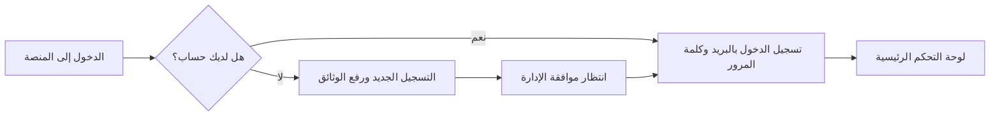

# 🚕 كتيب الإرشادات ودليل الاستخدام الشامل
## منصة «تاكسي نقيلو» (TAXI-NAGUILOU) لإدارة مؤسسات وسيارات الأجرة

---

## 📖 مقدمة: ما هي منصة تاكسي نقيلو؟
منصة **تاكسي نقيلو** هي نظام رقمي ذكي ومتكامل، صُمم خصيصاً لمساعدة أصحاب مكاتب سيارات الأجرة، والناقلين، ومؤسسات النقل الحضري على إدارة أعمالهم اليومية بكل سهولة واحترافية. 

تجمع المنصة بين إدارة الأسطول، متابعة السائقين، توثيق العقود القانونية، ضبط الحسابات المالية، والتنبيه التلقائي قبل انتهاء صلاحية أي وثيقة رسمية، وكل ذلك في واجهة واحدة بسيطة وسريعة تعمل على الحاسوب والهاتف الذكي معاً.

---

## 👥 من يستخدم المنصة؟ (أنواع الحسابات)

1. **المشرف العام / مدير المؤسسة (Super Admin / Admin):**
   - يملك كامل الصلاحيات لإدارة الشركة، قبول السائقين، تحصيل الاشتراكات، إصدار العقود، ومتابعة الأرباح والتقارير.
2. **مالك سيارة الأجرة (Owner / Propriétaire):**
   - صاحب المركبة أو رخصة الاستغلال؛ يمكنه متابعة سياراته، الاطلاع على العقود، ومعرفة حالة دفع الاشتراكات والوثائق.
3. **السائق (Driver / Chauffeur):**
   - السائق النشط أو البديل؛ يمتلك بطاقته المهنية الإلكترونية (QR Code)، ويتابع مواعيد وثائقه (الرخصة، الفحص الطبي)، ويقدم طلبات الإجازات.

---

## 🚀 البداية: تسجيل الدخول وبدء العمل

### 1. الدخول إلى حسابك (`/login`):
- افتح الرابط: `https://www.taxi-naguilou.com/login`
- أدخل **بريدك الإلكتروني** و**كلمة المرور**.
- يمكنك تبديل لغة الموقع (عربي 🇩🇿 / فرنسي 🇫🇷) بضغطة زر أعلى الشاشة.
- **في حال نسيت كلمة المرور:** اضغط على «نسيت كلمة المرور»، وسيصلك رمز مكوّن من 6 أرقام على بريدك لإعادة تعيين كلمة جديدة في ثوانٍ.

### 2. تسجيل حساب جديد (`/register`):
- إذا كنت سائقاً جديداً، اضغط على «تسجيل جديد»، واملأ بياناتك الأساسية (الاسم، الهاتف، رخصة السياقة).
- بعد التسجيل، تظهر لك صفحة الانتظار والتحقق (`/welcome`)، حيث تقوم الإدارة بمراجعة ملفك وتفعيل حسابك خلال وقت وجيز.

---

## 🖥️ جولة شاملة في صفحات المنصة وأقسامها

---

### 1. لوحة التحكم الرئيسية (Tableau de Bord / Overview)
> **الهدف:** شاشتك الصباحية التي تعطيك نظرة فورية شاملة على كل ما يحدث في مؤسستك دون الحاجة للدخول في تفاصيل معقدة.

* **بطاقات الأرقام والمؤشرات السريعة:**
  * **إجمالي الأسطول:** كم سيارة تابعة لمؤسستك، وكم سيارة تعمل في الخدمة حالياً، وكم سيارة موقوفة مؤقتاً.
  * **إجمالي السائقين:** عدد السائقين النشطين والمسجلين.
  * **العقود السارية:** كم عقد عمل نشط وكم عقد تم إنهاؤه.
  * **مؤشرات الفوترة والمداخيل:** المبالغ التي تم تحصيلها هذا الشهر بالدينار الجزائري (DZD)، والمبالغ التي لا تزال في انتظار الدفع، وعدد المركبات التي دفعت اشتراكها.
* **منحنى الأرباح والنمو:** رسم بياني يوضح تطور مدخول المؤسسة شهراً بشهر خلال السنة.
* **شريط النشاطات الأخيرة:** يسجل لك فوراً: من انضم جديداً، من قام بتسديد اشتراكه، وأي عقد تم توقيعه مؤخراً.

---

### 2. قسم المركبات والأسطول (Véhicules & Flotte)
> **الهدف:** الملف التقني والإداري لكل سيارة أجرة؛ يضمن لك ألا تسير أي سيارة بوثيقة منتهية الصلاحية تجنباً للغرامات والمشاكل المرورية.

#### أ) ما هي المعلومات المسجلة لكل سيارة؟
* **بيانات السيارة:** الماركة (مثل: هيونداي، داسيا)، الموديل (مثل: أكسنت، لوغان)، اللون، ورقم لوحة الترقيم (الماتريكول).
* **رقم الباب (Numéro de Porte):** الرقم المعتمد لسيارة الأجرة على الأبواب الجانبية وفق تنظيمات مديرية النقل.
* **سجل الوثائق وتواريخ الصلاحية:**
  1. 📄 **تاريخ انتهاء التأمين (Assurance):** موعد تجديد عقد التأمين.
  2. 🔧 **المراقبة التقنية (Contrôle Technique):** تاريخ الفحص الدوري للسيارة.
  3. 🧯 **قارورة الإطفاء (Extincteur):** تاريخ صلاحية قارورة إطفاء الحريق الإلزامية.
  4. ⛽ **فحص سيرغاز (GPL):** تاريخ صلاحية خزان الغاز وشهادة المطابقة الخاصة به.
  5. ⏱️ **عداد التاكسي (الساكوريومتر):** تاريخ شهادة مطابقة العداد، أو الإشارة إلى أن المركبة تعمل بدون عداد.
  6. 📁 **الوثائق المرفوعة:** يمكنك تصوير البطاقة الرمادية، رخصة الاستغلال، والتأمين وحفظها في المنصة للرجوع إليها في أي وقت.

#### ب) كيفية إضافة سيارة جديدة؟
1. ادخل إلى صفحة «المركبات» واضغط على زر **«إضافة مركبة»**.
2. اختر السائق أو المالك التابع له السيارة.
3. أدخل رقم الترقيم ورقم الباب وتواريخ الوثائق.
4. ارفع صور الوثائق إن وجدت، ثم اضغط **«حفظ»**. تصبح السيارة نشطة وتدخل فوراً ضمن الحسابات والأسطول.

---

### 3. قسم السائقين والملاك (Chauffeurs & Propriétaires)
> **الهدف:** إدارة شاملة للهوية المهنية للسائقين وحفظ حقوقهم وواجباتهم.

* **بيانات السائق:** الاسم، اللقب، رقم الهاتف، ورقم بطاقة التعريف الوطنية.
* **الرخص والشهادات:**
  * رقم رخصة السياقة وتاريخ نهايتها.
  * تاريخ صلاحية الشهادة الطبية العامة والصدرية الإلزامية لسائقي سيارات الأجرة.
  * رخصة استغلال سيارة الأجرة (تاريخ الإصدار وتاريخ النهاية).
* **بطاقة السائق الإلكترونية (QR Code):**
  * يحصل كل سائق على رمز استجابة سريع (QR) خاص به، يمكن مسحه بالهاتف الذكي للتأكد الفوري من هويته وصلاحية وثائقه وحالة سيارته.
* **فترات التربص (Probation):** متابعة السائقين الجدد خلال فترة التجريب للتأكد من انضباطهم قبل التثبيت النهائي.

---

### 4. قسم العقود والتوقيع الإلكتروني (Contrats de Travail)
> **الهدف:** حماية المؤسسة والسائق قانونياً من خلال عقود عمل نظامية جاهزة دون الحاجة لكتابتها يدوياً.

* **عقد عمل قانوني 100%:**
  * يحتوي النظام على صيغة عقد عمل رسمية مكوّنة من **16 مادة قانونية** مصممة وفقاً للقانون الجزائري **رقم 11/90 المتعلق بعلاقات العمل**.
  * تحدد مواد العقد مدة العمل (عادة 5 سنوات قابلة للتجديد)، فترة التجربة (6 أشهر)، حقوق والتزامات السائق، مسؤولية الأضرار، واحترام النظام الداخلي وقوانين المرور.
* **التوقيع الرقمي بضغطة زر:**
  * يتم إنشاء العقد آلياً برقم تسلسلي خاص (مثل `CT-2026-0086`).
  * يستطيع السائق والمدير التوقيع على الشاشة بالأصبع أو بقلم الهاتف (Signature Électronique).
  * بعد التوقيع، يتم تثبيت العقد ويمكن تحميله وطباعته بصيغة PDF لتقديمه للجهات الإدارية.

---

### 5. قسم الإجازات والسائق البديل (Congés & Remplacements)
> **الهدف:** ضمان ألا تتوقف سيارة الأجرة عن العمل عند خروج السائق الأصلي في عطلة.

* **كيف يعمل هذا القسم؟**
  1. يطلب السائق إجازة (عطلة سنوية، طارئ عائلي، أو ظرف صحي) مع تحديد تاريخ البداية والنهاية.
  2. يقوم مدير المؤسسة بالموافقة على الطلب وتعيين **«سائق بديل» (Chauffeur Remplaçant)** لنفس السيارة خلال تلك الفترة.
  3. خلال أيام الإجازة، يسجل النظام أن السيارة يقودها السائق البديل تلقائياً، وعند انتهاء الإجازة تعود السيارة باسم السائق الأصلي دون أي لخبطة في السجلات.

---

### 6. قسم الفوترة والاشتراكات (Facturation & Abonnements)
> **الهدف:** ضبط الحسابات المالية وضمان تحصيل المستحقات الشهرية باحترافية.

* **جدول اشتراكات السيارات:**
  * قائمة توضح كل سيارة: كم المبلغ المطلوب منها شهرياً، وهل تم الدفع أم لا.
  * علامة **«مدفوع - Paid»** باللون الأخضر، أو **«في الانتظار - Pending»** باللون البرتقالي.
* **طرق الدفع والتحصيل:**
  * يدعم النظام وسائل الدفع الشائعة في الجزائر:
    * الدفع نقداً بالمكتب مع وصل استلام.
    * التحويل عبر الحساب البريدي الجاري (**CCP**) أو نظام **RIP/Baridimob**.
    * التحويل البنكي المباشر.
* **تأكيد الدفع:** بمجرد استلام التحويل، يضغط المدير على «تأكيد الدفع» فتتحول حالة السيارة إلى مسددة وتضاف القيمة تلقائياً للمداخيل الإجمالية.

---

### 7. قسم المحاسبة والمداخيل (Finances)
> **الهدف:** رؤية واضحة لأرباح المؤسسة دون الحاجة لمحاسب خارجي للعمليات اليومية.

* **الملخص المالي العام:** يعرض مجموع الأموال المحصلة، والمستحقات المتبقية في ذمة السائقين.
* **التفصيل السنوي والشهري:** شاشات ورسوم بيانية توضح كم حققت المؤسسة في كل شهر من السنة، ومقارنة الأشهر ببعضها لمعرفة فترات الذروة والنشاط.

---

### 8. جداول المداومة والإرسال (Bordereaux de Permanence)
> **الهدف:** تنظيم العمل في عطلات نهاية الأسبوع والأعياد والمناوبات الليلية طبقاً لتعليمات مديرية النقل.

* يتم إنشاء جدول المناوبة بتحديد أرقام سيارات الأجرة والسائقين المكلفين بالعمل في كل يوم أو أسبوع.
* يمكن استخراج وطباعة **«جدول الإرسال»** الرسمي لتقديمه لمصالح مديرية النقل أو مصالح الأمن الوطني عند نقاط المراقبة.

---

### 9. تأمينات الضمان الاجتماعي (CNAS)
> **الهدف:** متابعة الوضعية القانونية والتأمينية للسائقين الأجراء.

* تسجيل أرقام الضمان الاجتماعي للسائقين.
* متابعة التصريحات بالعمال الأجراء لتفادي أي مخالفات مع مفتشية العمل ومصالح الضمان الاجتماعي للعمال الأجراء (CNAS).

---

### 10. المحادثات والمكالمات الصوتية المباشرة (Chat & Appels Vocaux)
> **الهدف:** تواصل فوري مباشر ومجاني بين الإدارة وجميع السائقين داخل المنصة.

* **الدردشة الكتابية:** إرسال رسائل وتوجيهات فورية لأي سائق في الميدان.
* **المكالمات الصوتية المجانية (WebRTC):**
  * زر اتصال صوتي مباشر داخل التطبيق؛ يمكنك الاتصال بالسائق والتحدث معه صوتياً عبر الإنترنت دون الحاجة لرصيد هاتفي.
  * يسجل النظام ملخص المكالمة ومدتها في سجل المحادثة.

---

### 11. نظام التنبيهات الذكية (Notifications)
> **الهدف:** المنصة هي من يتذكر المواعيد بالنيابة عنك!

* يرسل النظام إشعارات تلقائية قبل موعد انتهاء أي وثيقة:
  * 🔔 تنبيه قبل 30 يوماً وقبل 15 يوماً من انتهاء **تأمين السيارة**.
  * 🔔 تنبيه باقتراب موعد **الفحص التقني**.
  * 🔔 تنبيه بموعد تجديد **الشهادة الطبية للسائق**.
  * 🔔 تنبيه باقتراب انتهاء **صلاحية رخصة السياقة أو رخصة الاستغلال**.
  * 🔔 تنبيه بتسديد الاشتراكات الشهرية المستحقة.

---

### 12. إعدادات المؤسسة والهوية الجبائية (Paramètres Entreprise)
> **الهدف:** ضبط الوثائق الرسمية للمؤسسة لتظهر على جميع العقود والوصولات المطبوعة.

* **البيانات القانونية والجبائية (الجزائرية):**
  * **رقم السجل التجاري (Registre de Commerce):** رقم قيد الشركة.
  * **رقم المادة الضريبية (Article d'imposition).**
  * **رقم التعريف الجبائي (NIF).**
  * **رقم التعريف الإحصائي (NIS).**
* **بيانات الحسابات للتحصيل:**
  * رقم الحساب الجاري البريدي (**CCP**) والمفتاح.
  * رقم الهوية البريدية (**RIP**).
  * الحساب البنكي (RIB) واسم البنك.
* **هوية المؤسسة:** رفع شعار الشركة (Logo)، ليظهر تلقائياً في أعلى شاشة الدخول، رأسية العقود، وصولات الدفع، والتقارير المطبوعة.
* **المساعد الذكي (Douxe AI):** روبوت ذكي مدمج داخل المنصة يجيب على استفسارات المشرفين ويساعد في تحليل بيانات الأسطول وتقديم النصائح اليومية.

---

## 📋 جدول الملخص السريع للمستخدم

| ما الذي تريد القيام به؟ | إلى أي قسم تذهب؟ | الزر أو الإجراء المطلوب |
| :--- | :--- | :--- |
| **معرفة عدد السيارات الشغالة اليوم** | **لوحة التحكم (`/dashboard`)** | نظرة على بطاقة «المركبات النشطة». |
| **تسجيل سيارة جديدة ووثائقها** | **المركبات (`/dashboard/vehicles`)** | اضغط على زر **«إضافة مركبة»** واملأ البيانات. |
| **تجديد تأمين أو فحص تقني** | **المركبات أو التأمينات (`/dashboard/insurance`)** | اضغط على «تعديل» أمام السيارة وحدّث التاريخ. |
| **تسجيل سائق جديد بالهوية والرخصة** | **السائقون والملاك (`/dashboard/owners`)** | اضغط على **«إضافة سائق»**. |
| **إنشاء عقد عمل رسمي وتوقيعه** | **العقود (`/dashboard/contracts`)** | اضغط على **«إنشاء عقد»** ثم وقّع إلكترونياً. |
| **تعيين سائق بديل لسائق في عطلة** | **الإجازات (`/dashboard/leaves`)** | أضف طلب إجازة وحدد «السائق البديل». |
| **تسجيل استلام اشتراك شهري** | **الفوترة (`/dashboard/billing`)** | اضغط على **«تأكيد الدفع»** أمام السيارة. |
| **إخراج كشف المداخيل السنوي** | **المحاسبة والمالية (`/dashboard/finances`)** | استعرض تقرير السنة وحمّله كـ PDF. |
| **الاتصال بسائق في الميدان** | **المحادثات (`/dashboard/chat`)** | اختر اسم السائق واضغط على **أيقونة الهاتف 📞**. |
| **تغيير رقم الـ CCP أو شعار المؤسسة** | **الإعدادات (`/dashboard/settings`)** | عدّل البيانات واضغط على **«حفظ التغييرات»**. |

---

## ❓ الأسئلة الشائعة وحلول المشاكل (FAQ)

### 1. ماذا أفعل إذا ظهرت رسالة «الحساب قيد المراجعة» عند الدخول؟
- هذه رسالة طبيعية للسائقين الجدد (`PENDING_VALIDATION`)؛ تعني أن التسجيل نجح والطلب بانتظار موافقة مدير المؤسسة لمنحك صلاحية الدخول.

### 2. كيف أعرف أن تأمين إحدى السيارات أوشك على الانتهاء؟
- يظهر جرس الإشعارات في أعلى المنصة باللون البرتقالي أو الأحمر، كما تظهر شارة تحذير واضحة بجانب السيارة في جدول المركبات.

### 3. هل يمكن استخدام المنصة من الهاتف الذكي؟
- نعم، المنصة مبنية بنظام **تطبيق الويب التقدمي (PWA)** المتجاوب بالكامل مع شاشات الهواتف؛ ويمكنك تثبيتها كأيقونة تطبيق على الشاشة الرئيسية لهاتفك بنقرة واحدة من المتصفح.

### 4. هل العقود التي يتم توليدها ملزمة وقانونية؟
- نعم، بنود العقد مستخلصة ومحررة طبقاً لأحكام القانون 11/90 المتعلق بعلاقات العمل في الجمهورية الجزائرية الديمقراطية الشعبية، والتوقيع الإلكتروني معتمد وموثق بتوقيت النظام.

---

> 💡 **نصيحة ذهبية للإدارة:** يُستحسن في بداية كل شهر الدخول إلى قسم **الفوترة** وقسم **التأمينات** للتأكد من تسديد كافة الاشتراكات ومراجعة أي وثائق تحتاج للتجديد خلال الـ 30 يوماً القادمة للحفاظ على سير الأسطول بأعلى كفاءة.
